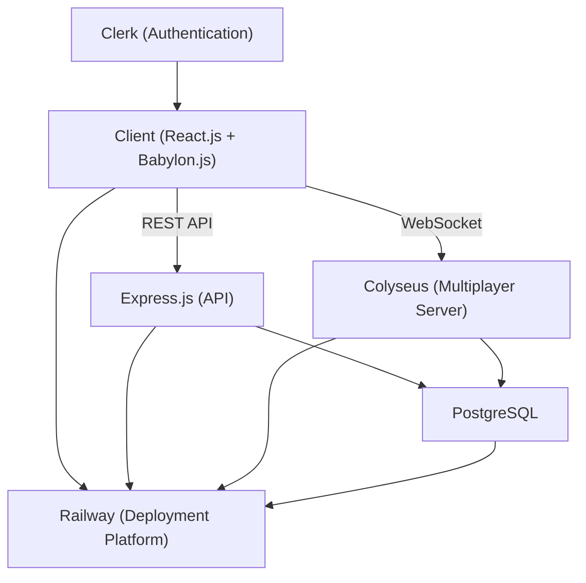

## Architecture Document

This document outlines the system architecture for "Toy Racers," explaining how the tech stack components work together to deliver a physics-driven, multiplayer racing experience. It ensures fairness, security, and scalability.

### System Overview

"Toy Racers" follows a client-server model:

- **Client (Front-End)**: Manages UI, 3D rendering, and user inputs.
- **Server (Back-End)**: Handles game logic, physics, multiplayer sessions, and data persistence.
- **Database**: Stores long-term data like player info and race results.

Communication occurs via RESTful APIs for non-real-time tasks and WebSocket for real-time race updates.

### High-Level Architecture Diagram

### Key Components and Interactions

#### 1. Front-End (Client)

- **React.js**

  - Manages UI elements like menus and race overlays.
  - Integrates with Clerk for authentication (e.g., sign-in screens).

- **Babylon.js**

  - Renders 3D race environments, updating visuals based on server data.
  - Supports camera switching for immersive gameplay.

- **Data Flow**
  - Sends requests (e.g., car selection) to the server via REST APIs.
  - Connects to Colyseus via WebSocket for real-time race updates.

#### 2. Back-End (Server)

- **Express.js**

  - Provides RESTful endpoints for tasks like:
    - Authenticating players with Clerk’s JWT.
    - Managing player data and race setups.

- **Colyseus**

  - Creates multiplayer rooms for races.
  - Runs authoritative game logic, including physics updates and race event detection.

- **Cannon.js**

  - Simulates physics (e.g., car movement, collisions) on the server.
  - Ensures consistent results across clients.

- **Data Flow**
  - Express.js interacts with PostgreSQL for persistent data.
  - Colyseus sends real-time updates (e.g., car positions) to clients.

#### 3. Database (PostgreSQL)

- Stores:
  - Player profiles.
  - Car attributes and collections.
  - Race history.
- Accessed by Express.js and Colyseus as needed.

#### 4. Networking (WebSocket via Colyseus)

- **Multiplayer**

  - Clients join Colyseus rooms for races.
  - The server broadcasts game state updates (e.g., every 50ms).
  - Clients interpolate these updates for smooth rendering.

- **RESTful API**
  - Handles non-real-time tasks like authentication and data retrieval.

#### 5. Authentication (Clerk)

- Issues JWTs upon login, which clients use for secure API calls and room access.
- Ensures only authenticated players participate.

### Multiplayer Architecture

- **Room Creation**: A Colyseus room is created for each two-player race.
- **Physics**: Cannon.js runs server-side simulations at a fixed rate (e.g., 60Hz).
- **Synchronization**: The server sends updates to clients, who render them with Babylon.js.
- **Events**: Race events (e.g., finish line) are detected server-side and broadcasted.

### Security

- **Authentication**: Clerk secures user accounts and sessions.
- **Data Protection**: JWTs validate requests; sensitive data is encrypted in PostgreSQL.
- **Fair Play**: Server-side physics and logic prevent client-side cheating.

### Deployment (Railway)

- Hosts all components (front-end, back-end, database).
- Supports scaling and long-running processes for multiplayer stability.
